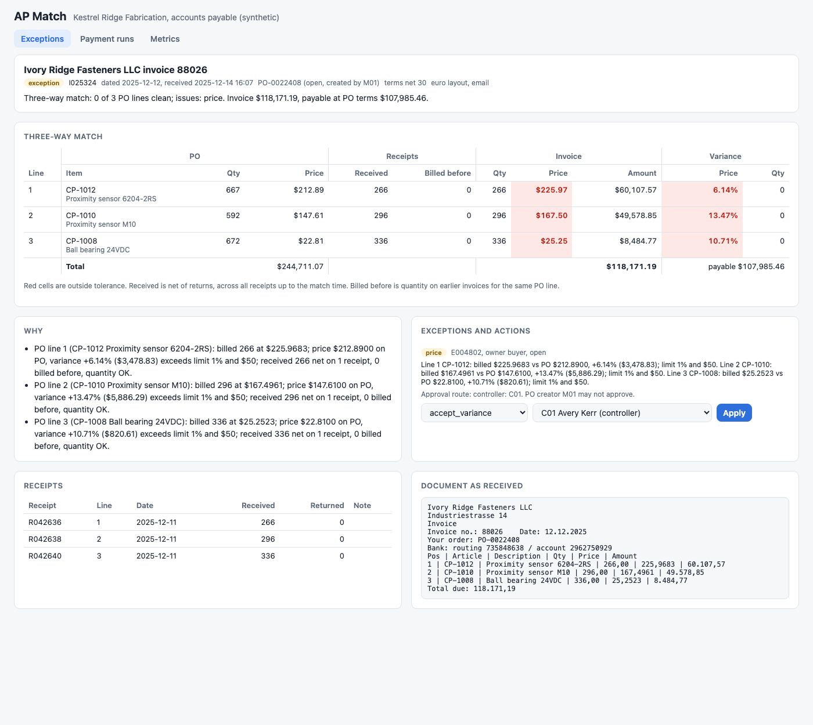

# AP Match

Accounts payable automation for Kestrel Ridge Fabrication, a made-up metal products manufacturer. It reads supplier invoices in four layouts, matches every line against the purchase order and the goods receipts, routes what does not match to the right person with an SLA, blocks duplicate and fraudulent invoices, and schedules payments to take early payment discounts when they beat the cost of cash. A seeded generator builds a year of procure-to-pay data (400 suppliers, 25,000 POs, 47,634 receipts, 29,345 invoices with planted problems) and a discrete-event simulator runs it through the back office, so every number below reproduces with `make simulate`.



| Metric (default run, seed 42, 27,609 invoices received by Dec 16, 2025) | Value |
|---|---|
| Touchless rate (matched and approved with no human touch) | 83.3% |
| Exception rate | 16.7%: price 5.6%, non-PO line 4.0%, quantity 2.3%, no receipt 2.0%, duplicate 1.4%, capture 0.9%, closed PO 0.6%, bank change 0.5% |
| Cycle time, received to approved | median 0.2 h touchless, 36.6 h with exceptions (p90 115 h) |
| Cost per invoice (modeled) | $3.44 |
| Early payment discounts | $8.69M captured of $8.82M worth taking (98.6%), $127K missed, $436K declined as below the 8% cost of cash |
| Days payable outstanding | 24.7 days, 0 invoices paid late |
| Planted duplicates approved for payment | 0 of 382 ($16.25M blocked) |
| Planted fraudulent bank changes approved | 0 of 114 ($5.25M blocked); 7 of 7 real bank changes verified and paid |
| Closed-PO invoices approved | 0 of 168 |
| Segregation of duties violations | 0 |

More views: [exceptions queue](docs/queue.png), [payment run planner (dark mode)](docs/payments.png), [metrics dashboard](docs/metrics.png).

## Why

Accounts payable is where a company's purchasing promises turn into cash leaving the bank, and most of the work is checking. Did we order this? Did it arrive? Is this the price we agreed? Have we already paid it? Is this really the supplier's bank account? A clean invoice should flow through with nobody touching it. The rest should land in front of the one person who can fix it (the buyer for price, receiving for quantity, treasury for bank details) with the evidence on one screen and a clock running. Meanwhile, paying a 2/10 net 30 invoice 20 days early earns 37% a year, so every day an exception sits is money. This repo builds that loop end to end and measures it.

## Worked example: a three-way match

Invoice `46972-K` from Granite Hill Corrugated Inc (`I001791`) is the second invoice on PO-0001595, after a split delivery. The supplier billed one PO line as two lots.

| PO line | PO qty and price | Receipts (net) | Billed before | This invoice | Result |
|---|---|---|---|---|---|
| 1 PK-1008 Stretch film | 1,177 at $3.09 | R002969 706 + R002970 471 = 1,177 | 706 | 235 + 236 = 471 at $3.5411 | quantity OK, price +14.60% ($212.47) over the 3% and $75 limit |
| 2 PK-1018 Strapping | 3,850 at $8.09 | R002971 1,540 + R002972 2,310 = 3,850 | 1,540 | 2,310 at $8.6403 | quantity OK, price +6.80% ($1,271.19) over the limit |

1. **Lines.** Invoice lines are assigned to PO lines by item code (description similarity is the fallback). Two invoice lines land on PO line 1, so their quantities and amounts are combined: many-to-one.
2. **Quantity.** Each PO line can have several receipts (one-to-many). Available = received net of returns, capped at ordered plus the category's over-delivery allowance, minus quantity on earlier invoices. 1,177 minus 706 leaves 471, exactly what was billed.
3. **Price.** Packaging allows 3% and $75 per line, and both must hold. Both lines fail, so a `price` exception goes to the buyer, with a 48 hour SLA.
4. **Resolution.** Above 5% the policy is to short pay at PO price: 471 x $3.09 + 2,310 x $8.09 = $20,143.29 instead of $21,626.95. (A smaller variance would be accepted, routed by amount: AP supervisor, purchasing manager, controller, CFO, skipping anyone who created the PO.)
5. **Payment.** Terms are 1/10 net 30: 1% for paying 20 days early is 0.01 / 0.99 x 365 / 20 = 18.4% a year, above the 8% cost of cash. The scheduler puts it on the last payment run inside the discount window (Thursday Feb 6) and takes $201.43 off.

Every line of that reasoning is generated text in the API (`GET /api/invoices/I001791/match`) and on the invoice page.

## Architecture

```
supplier invoice text (block, pipe, euro, letter layouts; scans with OCR noise; a few PDFs)
        |
        v
capture: layout detector -> deterministic parser per layout (default)      field confidence < 0.80
         or Claude Opus 5.5 with structured output (optional)          ---> capture exception (AP clerk)
        |
        v
controls: duplicate index (normalized number, fuzzy number + same amount, same content; 60 day window)
          closed PO, supplier mismatch, remit-to bank vs vendor master
        |
        v
match: two-way (services) or three-way at line level; tolerances by category (% and $),
       partial receipts, returns, over-delivery, many-to-one and one-to-many, prior billed qty;
       freight under $75 and correct sales tax auto-accepted; explanation for every line
        |
        v
exceptions queue: type -> owner -> SLA timer -> actions (accept variance with routed approval,
                  short pay, request credit memo, hold, reject, bank callback + second approver)
        |
        v
approval -> payment scheduler (Tue/Thu runs, discount vs cost of cash, due dates, credit memo netting)
        |
        v
FastAPI: /api/*, /healthz, /metrics (Prometheus), JSON logs, audit log -> web UI
```

| Piece | File |
|---|---|
| Policy: tolerances, terms, owners, SLAs, approval ladder, cost model | `src/apmatch/config.py` |
| Seeded generator with planted problems and ground truth | `src/apmatch/generator.py` |
| Four layouts: renderers and deterministic parsers | `src/apmatch/layouts.py` |
| Extractor interface, Claude extractor, field accuracy per layout | `src/apmatch/capture.py` |
| Line matching with tolerances and explanations | `src/apmatch/matching.py` |
| Duplicate index, segregation of duties, approval routing | `src/apmatch/controls.py` |
| The back office: ingest, exceptions, actions, bank change workflow, audit | `src/apmatch/engine.py` |
| Discount math, payment runs, DPO | `src/apmatch/payments.py` |
| Discrete-event simulation, KPIs, detection scoring, CI gate | `src/apmatch/pipeline.py`, `cli.py` |
| API, metrics, logs, UI | `src/apmatch/app.py`, `metrics.py`, `logs.py`, `static/index.html` |

## How it was measured

- **The simulated people follow a written policy, not the answers.** Price variance up to 5%: accept with approval. Over 5%, quantity, and big freight: short pay. Non-PO invoices: accept with a budget owner's approval. Closed PO and confirmed duplicates: reject. No receipt: wait for the receipt, then reject after 30 days. Two decisions need the outside world, so they read the generator's truth: a supplier answering treasury's callback about a bank change, and a supplier confirming whether an invoice was sent twice. Capture corrections key the true fields, as a clerk reading the image would.
- **Delays are assumptions.** Median hours from exception to action (5 for capture, 40 for price, 48 for no receipt, and so on) are lognormal draws set in `pipeline.py`. The cost model ($0.85 of system cost per invoice plus clerk minutes per touch at $48 an hour) is in `config.py`. Cycle time, SLA attainment, cost per invoice, and missed discounts all depend on these.
- **Detection scores are against planted problems.** Every exception type has 100% recall on the synthetic set, and precision is 100% except duplicates (99.5%: two legitimate split shipments looked like re-keyed duplicates and were released by a clerk). The rules were written knowing what the generator plants, so treat these as a check that the controls work as designed, not as an estimate of accuracy on real invoices.
- **Capture.** On all 29,345 generated invoices the offline parsers get every field right on 100% of block, pipe, and euro invoices and 95.3% of letters. The misses are scanned letters with a dropped decimal point in a unit price. The arithmetic check (qty x price vs amount) catches every one, drops the confidence to 0.3, and routes it to a clerk, so 0% are confident and wrong.
- **Choices that flatter the results.** The as-of date is December 16 so the queue has a realistic backlog of 50 open exceptions; a later date would show fewer. The CI touchless floor of 78% sits about 5 points below the measured rate: 82.6% to 83.7% on 8,000 PO runs with seeds 1, 2, 3, and 42, and 83.3% on the full run.

## How to run

```bash
cd ap-match
uv sync --python 3.12
make test                 # 117 tests, about 10 seconds
make simulate             # a year of AP on 25,000 POs, prints the table above, writes data/report.json (25 to 70 s)
make run                  # API and UI on http://127.0.0.1:8887 (simulates the year at startup, 25 to 70 s)
APMATCH_POS=5000 make run # faster startup on a smaller company
```

Try the API:

```bash
# Re-submit an invoice that was already paid in the simulated year: it comes back as a duplicate exception
curl -s -X POST localhost:8887/api/invoices -H 'content-type: application/json' \
  -d "{\"text\": $(python3 -c 'import json;print(json.dumps(open("examples/invoice-pipe.txt").read()))')}"
curl -s "localhost:8887/api/exceptions?type=price&overdue=true"
curl -s localhost:8887/api/invoices/I001791/match
curl -s -X POST localhost:8887/api/exceptions/<id>/actions -H 'content-type: application/json' \
  -d '{"action": "accept_variance", "actor": "C01", "note": "agreed surcharge"}'   # 403 if the actor created the PO
curl -s "localhost:8887/api/payments/plan?cost_of_cash=0.12"
curl -s localhost:8887/api/payments/proposal
curl -s localhost:8887/metrics
```

Endpoints: `POST /api/invoices`, `GET /api/invoices`, `/api/invoices/{id}`, `/api/invoices/{id}/match`, `/api/exceptions?type=&owner=&status=&overdue=`, `/api/exceptions/{id}`, `POST /api/exceptions/{id}/actions`, `/api/payments/plan?cost_of_cash=`, `/api/payments/proposal?run_date=`, `/api/summary`, `/api/people`, `/api/audit`, `/healthz`, `/metrics`.

Optional Claude extractor for live ingest (the simulated year always uses the offline parsers):

```bash
uv sync --python 3.12 --extra claude
export ANTHROPIC_API_KEY=...       # never commit it; see .env.example
APMATCH_EXTRACTOR=claude make run
uv run apmatch eval-capture --extractor claude --limit 50   # field accuracy per layout, one API call per invoice
```

The Claude extractor asks `claude-opus-5-5` for the same fields with structured output (a JSON schema where every field carries a value and a confidence). Low confidence on any field sends the invoice to a clerk, exactly as with the parsers. It has only been tested against a fake client here.

A few invoices are also rendered as simple PDFs with reportlab: `uv sync --extra pdf && uv run apmatch pdfs`. Samples are in `examples/pdf/`. Capture reads the text layer, which is the same text as the text rendering.

Docker is not needed locally. The `Dockerfile` (multi-stage, non-root user, HEALTHCHECK) is built and smoke tested in CI.

## Tests

117 tests (`make test`), about 10 seconds:
- each layout parser, credit memos per layout, numbers with spaces, OCR repair, dropped decimals, mangled documents
- field accuracy scoring, the Claude extractor's request shape, confidence clamping, refusals, cut-off and invalid replies, against a fake client
- tolerance rules (percent, dollar cap, both, under-billing, services), partial receipts, returns, over-delivery within and beyond tolerance, receipts after the match time, prior billed quantity, many-to-one and one-to-many, description fallback, lines not on the PO, two-way match, freight and tax rules
- invoice number normalization, fuzzy numbers, same content, the window, hard negatives, credit memo separation
- every exception type through the engine, the bank change workflow (callback, second approver, failed callback), segregation of duties, approval limits and escalation, short pay, receipt posted, not a duplicate, capture correction, SLA timers and queue filters
- discount math (2/10 net 30 = 37.2% a year), run days, take, decline, missed, late, DPO, credit memo netting
- KPI math on a hand-built set, the gate, the CLI, and the API end to end on a 2,000 PO run

CI (`.github/workflows/ci.yml`) runs ruff, the tests, a controls gate that simulates 8,000 POs and fails if any planted duplicate or fraudulent bank change invoice is approved for payment, if a PO creator approved a variance, or if the touchless rate drops below 78%, and a Docker build with a container smoke test.

## Production notes

- Capture would read real PDFs and images: a text layer when there is one, OCR when there is not, and the Claude extractor for layouts with no parser. A labeled sample per supplier layout sets the confidence floor, and field accuracy is tracked per supplier, since one new template can sink the touchless rate.
- The vendor master, POs, and receipts would come from the ERP by change data capture, and payment files would go out as NACHA or ISO 20022 through the bank's API. Positive pay and a cooling-off period after any bank detail change are standard extra controls.
- Duplicate detection would add cross-entity checks (the same supplier under two vendor IDs) and look back two years, with the index in a database instead of memory.
- Tolerances, approval limits, and the cost of cash are policy. Finance owns them, every change is versioned and audited, and the approval matrix would come from the HR system so it follows people as they change roles.
- The exception queue would sit in a workflow tool with assignment, escalation on SLA breach, and supplier messaging, and the audit log would be append-only storage that AP staff cannot edit.

## License

MIT. See [LICENSE](LICENSE).
